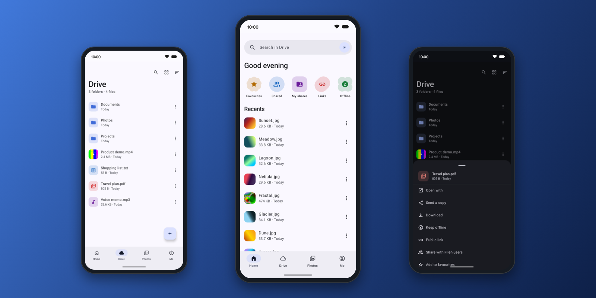

<div align="center">


# nubo

**Open-source client for the Filen cloud on Android.**<br>
End-to-end encrypted, fast and private. No trackers, no Google Play Services, no native code.

[](#build)
[](#security)
[](https://github.com/Turtlecute33/nubo/releases)
[](LICENSE)



</div>

## About

nubo is an unofficial app for [Filen](https://filen.io), the end-to-end encrypted cloud storage. It
shows your drive, your photos and your shares, and it moves files in both directions. Your files
are encrypted and decrypted on the phone: Filen gets only encrypted data.

nubo is new code in Kotlin. The Filen protocol and its encryption follow the
open Filen SDKs and their published test values. The interface is Jetpack Compose with Material 3
Expressive. The app has no native code, no WebView and no dynamic code loading, and it is made to
run on GrapheneOS. "Nubo" is the Esperanto word for "cloud".

## Features

- **Drive**: browse in a list or a grid, with a sort for each folder. Search, upload, download, new
  folder, rename, move, trash and restore, favourites and recent files.
- **Fast transfers**: parallel chunk uploads and downloads, a queue that goes on in the
  background, and one place that shows the progress. Share files from other apps to upload them.
- **Photos**: a timeline of a cloud folder, and camera upload of new photos and videos. Camera
  upload can wait for Wi-Fi, and it starts again by itself after a reboot.
- **Viewers in the app**: images (with zoom), video, audio, text and PDF.
- **Offline files**: keep files on the phone and open them with no network.
- **Sharing**: public links with an expiry date and a password (a paid Filen plan is necessary for
  links), read-only shares with other Filen users, and public Filen links that open in the app with
  no account.
- **App lock** with your fingerprint or your screen lock, and **screenshot blocking**.
- **Material 3 Expressive**: your wallpaper colours or the nubo blue, light, dark and pure black.

## Security

- **Your password stays on the phone.** The app derives the login secret on the phone (PBKDF2 or
  Argon2id, as Filen specifies). Filen gets only the derived value. The app does not store your
  password.
- **The session is encrypted** with an AES-256-GCM key in the Android Keystore (StrongBox when the
  phone has it), in storage that is not in backups.
- **No plain copy of your files on the disk.** Viewers decrypt into memory. "Open with" and "Send a
  copy" give the other app a file handle that decrypts while it reads; no decrypted file is
  written. Offline files stay encrypted as Filen stores them. Thumbnails are encrypted with a key
  of the session.
- **Downloads are checked.** Each 1 MiB chunk has its own authentication tag. A full download also
  checks the size and the BLAKE3 hash of the file, when the uploader wrote one.
- **Copied links do not stay.** A copied link is a sensitive clip, and the app clears it when you
  come back to the app.
- **Hardened app.** Hardware memory tagging (`memtagMode="sync"`) on GrapheneOS and Pixel, no
  cleartext traffic, system certificates only (a certificate that you or an admin add is not
  trusted), certificate transparency on Android 16 and later, and no backups. Touches through the
  overlays of other apps are dropped, and the keyboard does not learn from passwords, codes, names
  or links.
- **App lock** (optional) uses your fingerprint or your screen lock. It hides the app and its
  preview in recent apps; it does not encrypt data.
- **Logout** deletes the session, the offline files, the thumbnails and the queued transfers from
  the phone.

## Privacy

- No ads, no analytics, no crash reports, no Google Play Services, no third-party SDKs.
- nubo connects only to Filen:
  - `gateway.filen.io`: the API.
  - `ingest.filen.io`: uploads.
  - `egest.filen.io`: downloads. Downloads and public links carry no account key.
- The user agent is `nubo` on every phone. No device ID, install ID or push token.
- Search runs on the phone. nubo does not use Filen's server-side search index, which would upload
  hashes of parts of your file names.
- Camera upload does not ask for access to the location of your media, so Android removes the GPS
  position from the uploaded photos.
- Notifications show counts and percentages only, never file names. They do not show on a locked
  phone that has a screen lock, and do not go to a watch or a car.
- Settings › Support has links to donate and to the developer on X and Nostr. They open in your
  browser. The app itself does not connect to these hosts.
- What Filen can still see, with any client: your email address, your IP address and the times of
  use, the shape of your folder tree, the file sizes, who you share with, and which items have
  links. On accounts of auth version 1 and 2, Filen also gets an unsalted hash of each lower-case
  name, so it can test guesses of common names.

## Download

Get the APK from [Releases](https://github.com/Turtlecute33/nubo/releases). nubo is new software.
Report problems in [Issues](https://github.com/Turtlecute33/nubo/issues).

Before you install, check the signing certificate. Its SHA-256 fingerprint is:

```text
020142d2d84c7684bcb87f6ce08190aa1b2d213236077eb464d1ff8aa615cadd
```

Compare it with the output of `apksigner verify --print-certs <file>.apk`, or use AppVerifier.
Do not install an APK with a different certificate.

nubo needs Android 15 or later. It has no native code, so the same APK runs on all phones.

## Build

Requirements: JDK 21 and the Android SDK with platform 37.

```sh
JAVA_HOME=/opt/homebrew/opt/openjdk@21 ./gradlew :app:assembleDebug     # app ID app.nubo.debug
JAVA_HOME=/opt/homebrew/opt/openjdk@21 ./gradlew :app:testDebugUnitTest
```

Release builds are signed with the key that `scripts/make-release-key.sh` makes; without it,
`assembleRelease` makes an unsigned APK. The release APK is about 3 MB (estimate).

<details>
<summary><b>How it works</b></summary>

- **Login**: `/v3/auth/info` gives the salt and the auth version. The app derives the login secret
  and the key that opens the account keys, logs in with the secret, then reads the master keys (or
  the data key on v3 accounts) and the RSA key pair.
- **Metadata**: names and file keys are encrypted with AES-256-GCM in the Filen formats `002` and
  `003`; old `U2FsdGVk` data is read only.
- **Files**: each 1 MiB chunk is AES-256-GCM with a random nonce. Uploads hash each encrypted chunk
  (SHA-512) for the server, and the plain file (BLAKE3) for the metadata.
- **Shares and links**: a folder share or link holds a copy of the metadata of each item inside,
  encrypted for the receiver (RSA-OAEP-SHA512) or with the link key. Each new, moved or renamed
  item is added there too. The key of a public link is in the part of the URL after `#`, which no
  browser sends to a server.
- **Writes** take the same "drive-write" lock as the official apps, so they do not race with
  Filen's desktop sync.
- **Background work**: transfers that you start run as a user-initiated data transfer job, with a
  notification. Camera upload is a job that runs when new media come; a boot receiver schedules it
  again after a reboot.

The design notes are in [docs/DESIGN.md](docs/DESIGN.md), the protocol research in
[docs/research/protocol.md](docs/research/protocol.md).

</details>

<details>
<summary><b>Permissions</b></summary>

| Permission | Why |
|---|---|
| Internet, network state | The Filen hosts above; transfer jobs wait for a network. |
| Notifications | Transfer progress (asked at the first transfer) and camera upload problems. |
| Run user-initiated jobs | Transfers go on when you leave the app. |
| Photos and videos | Camera upload only, asked when you turn it on. |
| Receive boot completed | Camera upload starts again after a reboot. |
| Biometric | The optional app lock. |
| Hide overlay windows | Other apps cannot draw over nubo. |

No storage permission: uploads use the system file and photo pickers, and downloads go to
`Download/nubo` through MediaStore.

</details>

<details>
<summary><b>Project layout</b></summary>

- `app/src/main/kotlin/app/nubo/crypto`: key derivation and the Filen encryption formats.
- `app/src/main/kotlin/app/nubo/api`, `net`: the API envelope, login, and HTTPS through the
  platform HttpEngine (Cronet).
- `app/src/main/kotlin/app/nubo/drive`: listings, writes, sharing, links, upload and download.
- `app/src/main/kotlin/app/nubo/transfer`, `work`: the transfer queue, camera upload and
  notifications.
- `app/src/main/kotlin/app/nubo/media`, `offline`: thumbnails, streamed reads, "Open with" and
  offline files.
- `app/src/main/kotlin/app/nubo/data`: the Keystore vault, the session and the settings.
- `app/src/main/kotlin/app/nubo/ui`: theme, shared components, navigation and screens.

</details>

<details>
<summary><b>Validation</b></summary>

Run the JVM tests, lint and the two builds:

```sh
./gradlew :app:testDebugUnitTest :app:lintDebug :app:assembleDebug :app:assembleRelease
```

The tests (61) cover the crypto against the known-answer values of the Filen SDK, the v2 login with
two-factor codes against a scripted server, the download order, size and hash checks, the chunk
count, name rules, item decoding, sort order, the settings file, link URLs and link passwords, the
retry rule, the error texts, camera upload errors, search and the viewer cache.

On a Pixel 9 Pro XL with GrapheneOS and a test account with synthetic files, these steps were
tested: login, upload (empty, exactly 1 MiB and larger files), a download with the same SHA-256
as the source, a share of three files from another app, new folder, rename, trash, undo and
restore, search, offline files, and all viewers. The results are in
[docs/research/device-test.md](docs/research/device-test.md). The two reviews of the code are in
[docs/review](docs/review).

</details>

## Licence

GPL-3.0. Bouncy Castle (MIT) gives Argon2id and BLAKE3. Material Symbols are Apache-2.0.

<sub>nubo is not affiliated with, or endorsed by, Filen Cloud Dienste UG. "Filen" is their
trademark.</sub>
